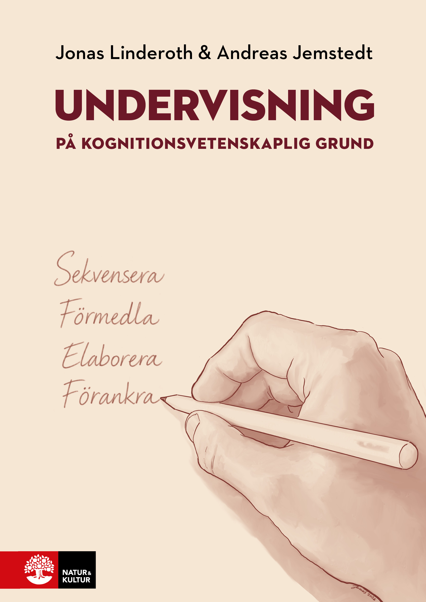

:::: {.container style="display: flex; flex-direction: row; flex-wrap: wrap; align-items: flex-start; gap: 20px; margin-bottom: 2em; text-align: left;"}
```{=html}
<div style="flex: 0 0 300px; max-width: 100%; margin: 0 auto; display: flex; flex-direction: column; align-items: center; gap: 2em;">

  

  <div style="width: 100%; border-top: 1px solid #ddd; padding-top: 1.25em; display: flex; flex-direction: column; align-items: center; gap: 0.8em; text-align: center;">

    <div style="font-size: 0.85em; font-weight: 700; letter-spacing: 0.14em; text-transform: uppercase; color: #6c1827;"><span class="sv">Ny bok</span><span class="en">New book</span></div>

    <a href="https://www.nok.se/titlar/laromedel-b2/undervisning-pa-kognitionsvetenskaplig-grund/" style="display: block; line-height: 0;">
      
    </a>

    <div>
      <div class="h5" style="margin: 0 0 0.25em 0;">Undervisning på kognitionsvetenskaplig grund</div>
      <div style="font-size: 0.9em; color: #555;"><span class="sv">Med Jonas Linderoth</span><span class="en">With Jonas Linderoth</span></div>
      <div style="font-size: 0.9em; color: #555;"><span class="sv">Natur &amp; Kultur, 2026</span><span class="en">Natur &amp; Kultur, 2026 · in Swedish</span></div>
    </div>

    <a href="https://www.nok.se/titlar/laromedel-b2/undervisning-pa-kognitionsvetenskaplig-grund/"><span class="sv">Om boken</span><span class="en">About the book</span></a>

  </div>

</div>
```

::: {style="flex: 1 1 400px; min-width: 0;"}
## [Forskning och undervisning]{.sv} [Research and Teaching]{.en}

::: sv
Jag är doktor i psykologi och docent vid Institutionen för pedagogik och didaktik vid Stockholms universitet. Min forskning handlar om hur människor lär sig, hur de gör bedömningar och fattar beslut, och hur detta formar deras beteende. För att förstå de här processerna använder jag gärna kvantitativa metoder, framför allt bayesiansk modellering.

Vid sidan av forskningen undervisar jag om hur kunskap från kognitionsvetenskap kan användas i olika utbildningssammanhang. Det kan till exempel handla om hur forskningen kan förbättra undervisningen i klassrummet, hur elever och studenter kan bli bättre på att styra sitt eget lärande och hur digitala lärresurser kan utformas.
:::

::: en
I have a PhD in psychology and work as an Associate Professor (Docent) in the Department of Education at Stockholm University. My research is about how people learn, how they make judgments and decisions, and how this shapes their behavior. To understand these processes, I often use quantitative methods, especially Bayesian modeling.

Alongside my research, I teach about how knowledge from cognitive science and research on learning can be used in education. Examples include how research can improve classroom teaching, how students can become better at managing their own learning, and how digital learning resources can be designed.
:::

## [Andra uppdrag]{.sv} [Other Work]{.en}

::: sv
Det mesta av mitt arbete är akademiskt, men jag bidrar också med min expertis i projekt utanför min egen forskning och undervisning. Det har bland annat handlat om föreläsningar och workshoppar, kursutveckling, rapportskrivande och kvantitativ dataanalys.

Jag är öppen för många olika typer av projekt, både inom och utanför akademin. Om du arbetar med något där min expertis kan komma till nytta, eller har data som du vill utforska, hör gärna av dig.

📩 [Kontakta mig](contact.qmd){.button}
:::

::: en
Most of my work is academic, but I also contribute my expertise to projects beyond my own research and teaching. This has included presentations and workshops, course design, report writing, and quantitative data analysis.

I'm open to a range of projects, both within and beyond academia. If you're working on something where my expertise could be useful, or have data you'd like to explore, I'd be happy to hear from you.

📩 [Contact me](contact.qmd){.button}
:::
:::
::::